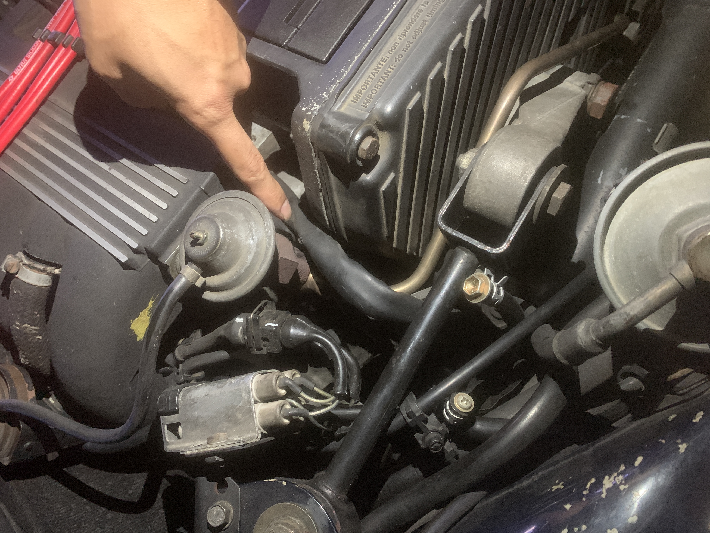
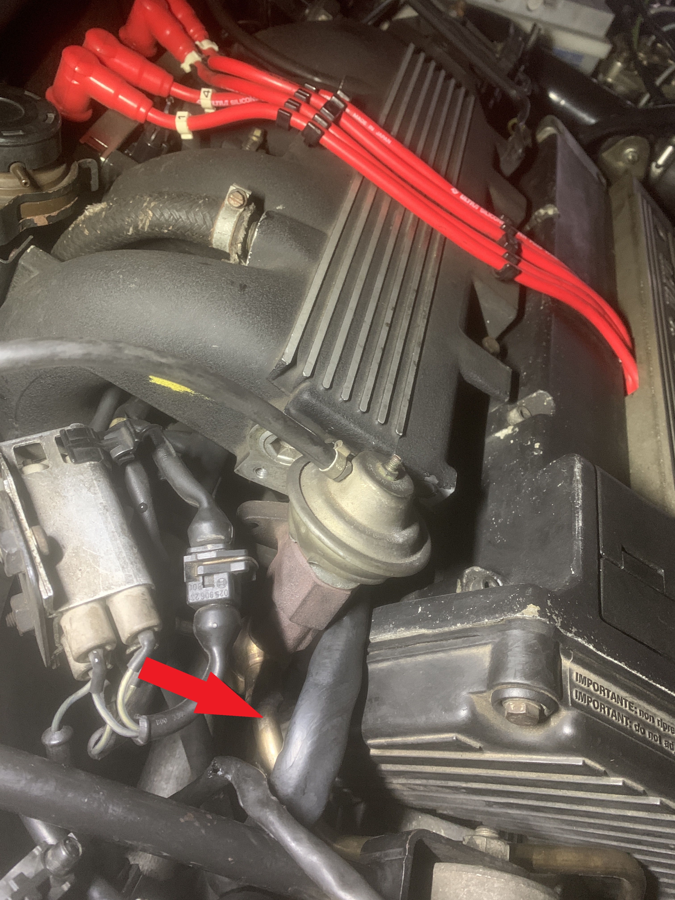
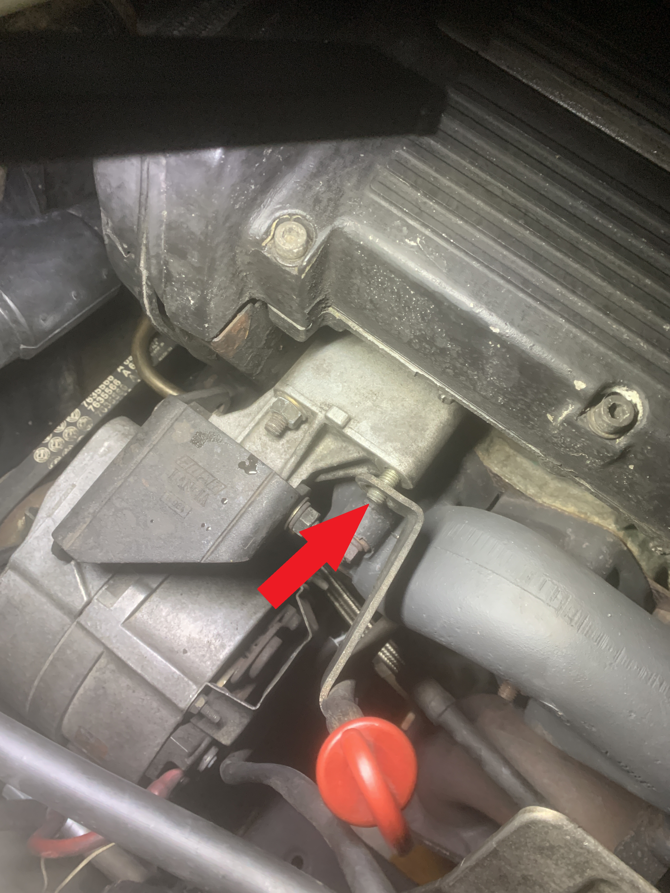
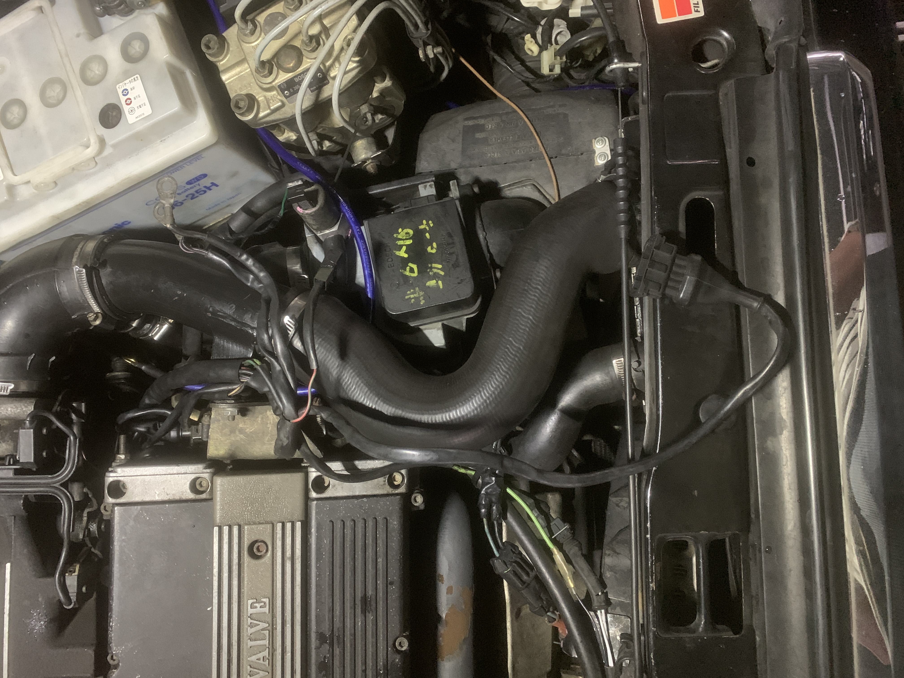
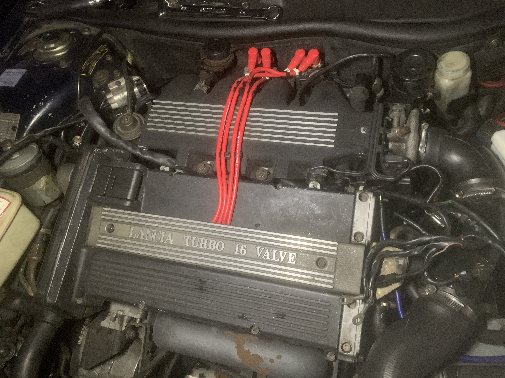
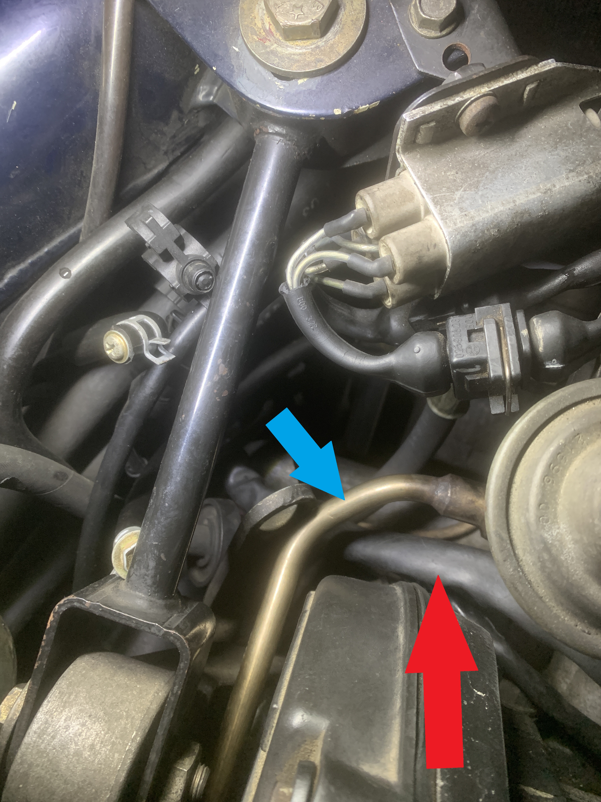
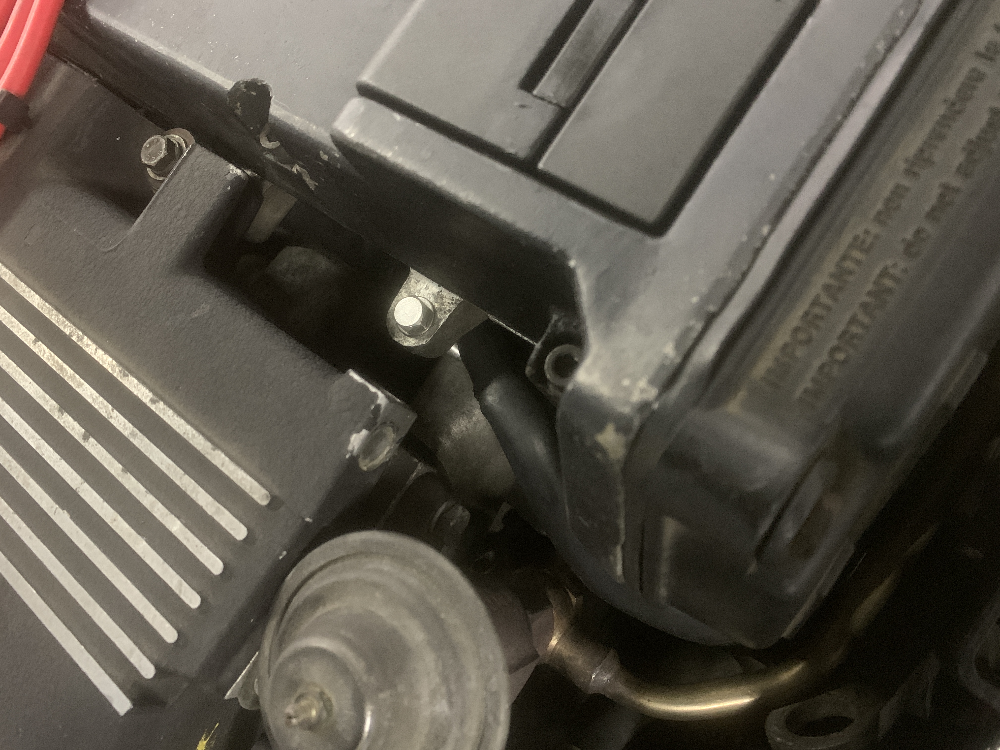

# はじめに
Dolceのテーマは基本的に純正ですが、今後の維持を目的としたモディファイが随所に散見され、その一つがオーナーでないと違いが判らないエンジンルームです。

過去に二度エンジンを載せ替えているためインテークの一部がワンオフになっているほか、各ホース類はすべて汎用品を切って作られています(ゴムの状態が良い純正品は手に入らないのだと思います)。同時にエンジンルーム内のハーネスも(おそらくすべて)引き直されており、本来車体下側を通る配線がエンジン上部を通るように変更されているため、配線修理や今後の載せ替え作業が平易な仕様になっています。

一方、エンジンヘッド近くを這わせたハーネスは危険も孕んでおり、EGRバルブに大きなハーネスが接触して被覆が焦げてしまっている箇所を発見してしまいました。

> 指さした先で配線が焦げています。左にある円筒状の部品がEGRバルブ。排ガスの循環装置ですので、エンジンルーム内でもかなり高温になる場所です。

今回はハーネスルートを一部変更し、焦げが進行して内部の配線を焼いてしまわないようにしてみます。

# ルートの変更
問題になっているEGRバルブはエンジンルーム向かって左側、インマニに接続されるかたちでついています。

現状のハーネスはEGRバルブに繋がる配管の上を通ってからサージタンクとタペットカバーの間に潜りこんでいて、上下方向の取り回しにやや難があります。

> 作業前のハーネス。赤矢印で示した配管の上をハーネスが通っています。

エキマニの脇からEGRバルブに繋がる配管が生えているので、まずはそちらを取り外します。22とかの割と大きめのナットを取り外して配管をフリーにします。

> 赤矢印で示したボルトに引っかかっているオイルレベルゲージのステーを取り外したりしたら配管が取れます。詳しい写真がなくて覚えていません。

このままバルブ側も外そうと思ったのですが、工具がうまく入らなかったので力が入らず取り外すことができませんでした。

そのため、ハーネス側をフリーにして丸ごと移動させる方向で作業します。

まずはハーネスが繋がっているカプラーを片っ端から取り外します。今回のハーネスですが、O2センサーや水温センサー、エアフロ、ISCVなどに繋がっており本当にエンジン制御の生命線と言える配線になっていました。本来はボディアースになっているであろうアース類もまとめてエンジンアースに変更されています。

> 色々外した状態。配線被覆の作り自体は非常に丁寧で、載せ替えた某ショップの腕の良さがうかがえます。

一通りコネクタを外したら慎重に配線を向かって左側から抜いていきます。

> 全体像。左から配線を引き抜いている途中です。

配線を引き抜いたらすべてまとめてEGRバルブ配管の下を通して戻します。

> 赤矢印の配線を、青矢印の配管の下に通します。

最後に、配線がEGRバルブに接触してしまわないよう、エンジンヘッドから飛び出ている余ったねじ穴にボルトを通して、配線を押さえるようにして完成です。

> 画面中央が差し込んだボルトです。ねじ穴が貫通しているのでそのまま下まで通し、配線を押さえています。

# おわりに
以上、今回はエンジンルームの軽い整備でした。定期的に走行後に配線が乱れていないかチェックしていますが、現状大丈夫そうです。発見できれば大事に至る前になんとかできる不具合はかなり多いと思いますので、日ごろからアンテナを張って乗りたいものですね。